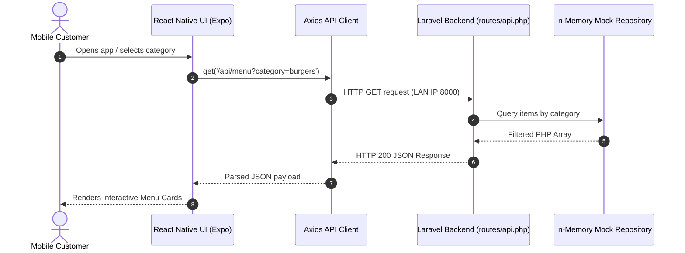

# System Implementation Guide - Mobile Ordering System

**Course:** ADET — Midterm Project  
**Topic:** React Native (Expo) + Laravel REST API (No Database)  
**System Concept:** Fast-Casual Food & Cafe Mobile Ordering App  

---

## 1. System Overview & Data Flow

The project architecture connects a mobile client built with **React Native (Expo)** to a **Laravel REST API** using **Axios**. Per project specifications, the backend requires **no database**; all records are held as structured in-memory datasets and returned directly as JSON.



---

## 2. Directory Structure

```text
Ordering System/
├── TODO.md
├── IMPLEMENTATION.md
├── backend/                        # Laravel REST API project
│   ├── app/
│   │   ├── Http/Controllers/Api/   # API Controllers (Store, Menu, Order)
│   │   └── Repositories/           # Mock data sources (No DB)
│   ├── config/cors.php             # Enabled CORS for Expo
│   ├── routes/api.php              # 5+ REST Endpoints defined here
│   └── composer.json
└── frontend/                       # React Native (Expo) project
    ├── assets/                     # App icons, splash, & local images
    ├── src/
    │   ├── api/                    # Axios client & service wrappers
    │   │   ├── client.js           # Base instance with LAN IP
    │   │   └── services/           # menuService, storeService, orderService
    │   ├── components/             # Reusable UI components
    │   │   ├── common/             # Buttons, Inputs, Modals
    │   │   └── features/           # MenuItemCard, CategoryPill, PromoBanner
    │   ├── constants/              # Global constants
    │   │   └── theme.js            # Brand colors, spacing, & typography
    │   ├── context/                # Global State
    │   │   └── CartContext.js      # Cart items, quantities, totals
    │   ├── hooks/                  # Custom React hooks (e.g., useCart)
    │   ├── navigation/             # AppNavigator (Tabs & Stacks)
    │   ├── screens/                # Full-page screen components
    │   │   ├── home/HomeScreen.js
    │   │   ├── menu/MenuScreen.js
    │   │   ├── menu/ItemDetailScreen.js
    │   │   ├── checkout/CartScreen.js
    │   │   └── checkout/OrderTrackingScreen.js
    │   └── utils/                  # Formatters (currency, dates)
    ├── App.js                      # Application Entry Point
    ├── app.json
    └── package.json                # Dependencies (including lucide-react-native)
```

---

## 3. Laravel API Specifications (No Database)

All responses strictly return standard JSON using `response()->json($data, $statusCode)`.

### Endpoint 1: Store Information
- **Method:** `GET`
- **Route:** `/api/store-info`
- **Purpose:** Fetches store profile, opening hours, address, and live status for the Home screen.
- **Sample Response (200 OK):**
```json
{
  "status": "success",
  "data": {
    "name": "Velvet Brew & Burger Co.",
    "tagline": "Crafted Burgers & Specialty Coffee",
    "isOpen": true,
    "operatingHours": "8:00 AM - 10:00 PM",
    "address": "123 University Avenue, Tech City",
    "rating": 4.9,
    "announcement": "Free delivery on orders over $25 today!"
  }
}
```

### Endpoint 2: Food & Beverage Categories
- **Method:** `GET`
- **Route:** `/api/categories`
- **Purpose:** Returns list of menu categories to populate filter tabs on Home and Menu screens.
- **Sample Response (200 OK):**
```json
{
  "status": "success",
  "data": [
    { "id": "cat_all", "name": "All", "icon": "layout-grid" },
    { "id": "cat_burgers", "name": "Burgers", "icon": "sandwich" },
    { "id": "cat_drinks", "name": "Coffee & Drinks", "icon": "coffee" },
    { "id": "cat_sides", "name": "Sides & Fries", "icon": "utensils-crossed" },
    { "id": "cat_desserts", "name": "Desserts", "icon": "ice-cream" }
  ]
}
```

### Endpoint 3: Menu Catalog (All & Filtered)
- **Method:** `GET`
- **Route:** `/api/menu?category={category_id}`
- **Query Params:** `category` (optional, e.g. `cat_burgers`)
- **Purpose:** Retrieves menu cards with image URLs, prices, ratings, and preparation time.
- **Sample Response (200 OK):**
```json
{
  "status": "success",
  "total": 2,
  "data": [
    {
      "id": 101,
      "categoryId": "cat_burgers",
      "name": "Smoked Truffle Bacon Burger",
      "price": 12.99,
      "rating": 4.9,
      "prepTime": "15-20 min",
      "isPopular": true,
      "imageUrl": "https://images.unsplash.com/photo-1568901346375-23c9450c58cd?w=600",
      "description": "Double Angus beef patty, smoked bacon, caramelized onions, and black truffle aioli."
    },
    {
      "id": 102,
      "categoryId": "cat_drinks",
      "name": "Iced Caramel Macchiato",
      "price": 5.49,
      "rating": 4.8,
      "prepTime": "5-8 min",
      "isPopular": true,
      "imageUrl": "https://images.unsplash.com/photo-1517701604599-bb29b565090c?w=600",
      "description": "Rich espresso layered with creamy whole milk and buttery vanilla caramel drizzle."
    }
  ]
}
```

### Endpoint 4: Single Item Details & Customizations
- **Method:** `GET`
- **Route:** `/api/menu/{id}`
- **Purpose:** Detailed view for modal/screen with ingredients, add-ons, and size variations.
- **Sample Response (200 OK):**
```json
{
  "status": "success",
  "data": {
    "id": 101,
    "name": "Smoked Truffle Bacon Burger",
    "price": 12.99,
    "description": "Double Angus beef patty, smoked bacon, caramelized onions, and black truffle aioli.",
    "imageUrl": "https://images.unsplash.com/photo-1568901346375-23c9450c58cd?w=600",
    "sizes": [
      { "name": "Regular", "extra": 0.00 },
      { "name": "Double Patty Meal", "extra": 3.50 }
    ],
    "addons": [
      { "id": "a1", "name": "Extra Cheddar Cheese", "price": 1.25 },
      { "id": "a2", "name": "Crispy Onion Rings", "price": 1.50 },
      { "id": "a3", "name": "Spicy Jalapenos", "price": 0.75 }
    ]
  }
}
```

### Endpoint 5: Promotions & Discount Banners
- **Method:** `GET`
- **Route:** `/api/promotions`
- **Purpose:** Retrieves promotional banners and discount codes displayed on Home and Cart.
- **Sample Response (200 OK):**
```json
{
  "status": "success",
  "data": [
    {
      "id": "promo_1",
      "title": "Midterm Combo Deal",
      "code": "MIDTERM20",
      "discountPercent": 20,
      "bannerColor": "#E65100",
      "subtitle": "Get 20% off on all Burgers & Iced Drinks"
    },
    {
      "id": "promo_2",
      "title": "Student Special",
      "code": "STUDENTFREE",
      "discountPercent": 15,
      "bannerColor": "#1565C0",
      "subtitle": "Flash student ID for extra perks"
    }
  ]
}
```

### Endpoint 6: Order Placement (Mock Checkout)
- **Method:** `POST`
- **Route:** `/api/orders`
- **Request Body:**
```json
{
  "customerName": "Alex Rivera",
  "orderType": "Dine-in",
  "tableOrAddress": "Table 04",
  "items": [
    { "id": 101, "name": "Smoked Truffle Bacon Burger", "quantity": 2, "price": 12.99 }
  ],
  "subtotal": 25.98,
  "discount": 5.20,
  "total": 20.78
}
```
- **Sample Response (201 Created):**
```json
{
  "status": "success",
  "message": "Order successfully placed!",
  "data": {
    "orderId": "ORD-2026-9812",
    "timestamp": "2026-10-02T13:45:00Z",
    "estimatedPrepMinutes": 20,
    "status": "Preparing",
    "totalCharged": 20.78
  }
}
```

---

## 4. Mobile Screen Specifications (5 Screens)

| Screen | Key Features & Elements | API Endpoints Used |
| :--- | :--- | :--- |
| **1. Home Screen** | Header with store info, promo carousel, category pills, popular items preview | `GET /api/store-info`<br>`GET /api/promotions`<br>`GET /api/categories` |
| **2. Menu Catalog** | Category switcher tabs, real-time search input, grid of menu cards with prices | `GET /api/categories`<br>`GET /api/menu` |
| **3. Item Detail** | Hero food image, description, size selection, add-on checkboxes, quantity adjuster, Add to Cart button | `GET /api/menu/{id}` |
| **4. Cart & Checkout** | Selected order items, quantity adjusters (+ / -), promo code input, order type selector (Dine-in / Takeaway), Place Order CTA | `POST /api/orders` |
| **5. Order Status / Receipt** | Order tracking steps (Order Placed ➔ Preparing ➔ Ready), estimated countdown, itemized bill, order code | Data passed from `POST /api/orders` |

---

## 5. Axios Client Setup & Network Critical Guidance

### ⚠️ Critical Note on React Native & Mobile Networking
When testing React Native on a physical phone via Expo Go or an emulator:
- **DO NOT USE `http://localhost:8000`** in the mobile app! To the phone, `localhost` refers to the phone itself, which will cause `Network Error` or `Connection Refused`.
- **USE YOUR LOCAL MACHINE'S LAN IP** (e.g., `http://192.168.1.XX:8000/api`) or your computer's Wi-Fi IPv4 address.

### Example Axios Client (`frontend/src/api/client.js`)
```javascript
import axios from 'axios';

// Replace with your local PC Wi-Fi IP address (run `ipconfig` in cmd/powershell)
export const BASE_API_URL = 'http://192.168.1.100:8000/api';

const apiClient = axios.create({
  baseURL: BASE_API_URL,
  timeout: 10000,
  headers: {
    'Content-Type': 'application/json',
    'Accept': 'application/json',
  },
});

// Interceptor for logging & debugging during development
apiClient.interceptors.response.use(
  (response) => response.data,
  (error) => {
    console.error('API Error:', error.response?.data || error.message);
    return Promise.reject(error);
  }
);

export default apiClient;
```

---

## 6. Step-by-Step Execution Plan

### Step 1: Start the Android Emulator
1. From the project root, open a PowerShell terminal.
2. Run the emulator script:
   ```powershell
   .\start-emulator.ps1
   ```
3. Wait for the device to fully boot.

### Step 2: Start Laravel Backend
1. Open a new terminal and navigate to the backend:
   ```powershell
   cd backend
   .\dev.ps1
   ```
   *(This script binds the API to `0.0.0.0:8000` so the emulator can reach it).*
2. Verify in your browser: `http://localhost:8000/api/store-info`

### Step 3: Start Expo Mobile App
1. Open a third terminal and navigate to the frontend:
   ```powershell
   cd frontend
   npx expo start --android
   ```
2. The app will automatically build and install on your running emulator.
3. Verify that requests hit the Laravel backend console and display data in the emulator.
